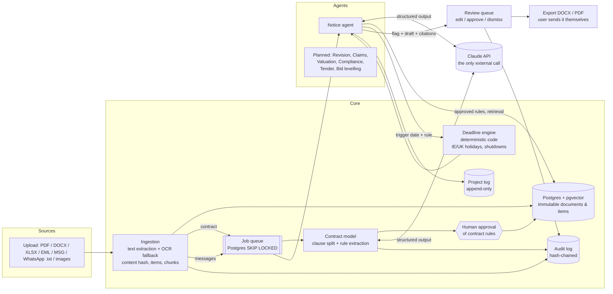

# Notice

An AI commercial assistant for main contractors and specialist subcontractors in Ireland and the UK. Notice reads
contracts, emails, WhatsApp exports and site diaries, and runs agents that do the commercial admin that loses
contractors money: spotting changes and delays, starting the contractual clock, and drafting the notice.

**Agents draft, humans approve.** Nothing is sent from Notice. Every output cites the exact passage it relied on.
Deadlines are calculated by code, never by the model.

> Status: **Phase 1** (core platform + Notice agent) is built. Revision, Claims, Valuation, Compliance, Tender and
> Bid levelling agents are planned (see [docs/PLAN.md](docs/PLAN.md)); their demo data is already generated.

---

## Quick start

### Docker

```bash
cp .env.example .env            # optionally add ANTHROPIC_API_KEY
docker compose up -d --build
docker compose exec api python -m seed.load_demo     # load the Riverside Apartments demo
open http://localhost:3000      # demo@brennock.example / riverside-demo
```

### Without Docker

Needs Python 3.12+, Node 22, PostgreSQL 16 with the `pgvector` extension, and `tesseract-ocr` + `poppler-utils`
for OCR.

```bash
python -m venv .venv && . .venv/bin/activate
pip install -r backend/requirements.txt
createdb notice && createdb notice_test        # user/password notice/notice by default (see .env.example)

cd backend
alembic upgrade head
python ../demo_data/generate.py                # (re)generate the synthetic project files
python -m seed.load_demo --reset               # load the demo project; runs all agents
uvicorn notice.main:app --port 8000 &          # API
python -m notice.jobs.worker &                 # background agent worker
cd ../web && npm install && npm run dev        # UI on http://localhost:3000
```

### Tests and eval

```bash
cd backend
pytest -q                                              # deadline engine, units, full API flow (needs notice_test DB)
python ../evals/notice_agent/run_eval.py               # offline baseline
python ../evals/notice_agent/run_eval.py --provider claude   # needs ANTHROPIC_API_KEY
```

### LLM provider

| `NOTICE_LLM_PROVIDER` | Behaviour |
|---|---|
| `auto` (default) | Claude if `ANTHROPIC_API_KEY` is set, otherwise offline |
| `claude` | Anthropic Claude (`claude-opus-5-5`), structured outputs validated against Pydantic schemas, server-side refusal fallback on |
| `offline` | Deterministic rules/templates. Lets the platform, tests and eval run with no network; it is a baseline, not the product |

The UI shows which provider produced the outputs (bottom left), and every `agent_runs` row records the provider,
model, prompt id and version.

---

## Architecture



### Notice agent pipeline

1. **Classify** the message as change / delay / instruction / disruption / noise, with evidence quotes, a trigger
   (awareness) date and links to *approved* contract rules (`prompts/notice_agent/classify.v1.md`).
2. **Verify in code**: every quote must be found in the message (otherwise confidence is cut); linked rule ids must
   be approved rules; implausible trigger dates are replaced by the message date; issues are recorded.
3. **Group**: if the message is about an event already on the register, it is attached as evidence and no new
   clock starts (the clock runs from first awareness).
4. **Deadline**: the deadline engine computes the due date from the rule's period and unit, the project's holiday
   region, weekends and shutdowns, and stores a step-by-step trace.
5. **Draft** the notice in the contract's language, using the clause text and the contract's form-of-notice clause
   found by retrieval (`prompts/notice_agent/draft_notice.v1.md`). Draft citations are verified too.
6. **Review item** in the inbox: category, confidence (amber if below `NOTICE_LOW_CONFIDENCE_THRESHOLD`), triggering
   passage, clause passage, deadlines with trace, editable draft. Approve → export DOCX/PDF → mark issued (stops the clock).

### Repository layout

```
backend/notice/
  ingestion/     extractors (pdf, docx, xlsx, eml, msg, whatsapp, diary, OCR) and ingest service
  contract/      clause splitter, extraction schemas, offline extractor, approval workflow
  deadlines/     calendar + engine (pure, unit-tested)
  agents/        base contract (run_task + tools), citations, registry, notice_agent/
  review/        review queue actions; every action logged with before/after
  record/        project log + hash-chained audit log
  llm/           prompt loader, ClaudeProvider, OfflineProvider
  retrieval/     local hashing embedder + pgvector search
  jobs/          Postgres-backed queue and worker
  api/           FastAPI routers
backend/alembic/ migrations (incl. immutability triggers)
backend/seed/    demo loader
prompts/         versioned prompt files <agent>/<task>.v<N>.md
demo_data/       synthetic Riverside Apartments project + generator
evals/           Notice agent eval harness and labelled dataset
web/             Next.js + TypeScript + Tailwind UI
docs/PLAN.md     repo structure, data model, phase plan
```

### Data model (summary)

`organisations → users`, `projects → parties, project_shutdowns`. Source material: `documents` (immutable, content
hash unique per project) → `items` (atomic messages with character offsets) → `chunks` (pgvector embeddings).
Contract: `contracts → contract_clauses, contract_rules` (proposed → approved/rejected). Record: `events`,
`deadlines` (with computation trace), `drafts`, `agent_runs`, `review_items`, `review_actions`, `project_log`,
`audit_log`, `jobs`. Full table in [docs/PLAN.md](docs/PLAN.md).

### Guarantees and where they are enforced

| Guarantee | Enforced by |
|---|---|
| Source documents can't be altered or deleted | Postgres triggers on `documents`, `items` |
| Audit and action logs are append-only and tamper-evident | Triggers on `audit_log`, `project_log`, `review_actions`; SHA-256 chain, `GET /api/audit/verify` |
| Deadlines come from code | `notice/deadlines`; the model is told not to compute dates and its dates are never used as due dates |
| Agents only use human-approved contract rules | `tool_approved_rules`, `verify_classification` |
| Citations point at real text | `agents/citations.py` locates every quote and stores exact offsets; unverifiable quotes are dropped and lower confidence |
| Nothing is sent | There is no email/SMTP code. Approved drafts export to DOCX/PDF; the user marks them issued |
| Tenancy | Every route resolves the project through the user's organisation (`api/deps.py`) |
| Data residency | Embeddings are computed locally; the only outbound call is the Claude API (choose an EU-hosted deployment or provider if required) |

---

## Adding a new agent

1. **Package**: create `backend/notice/agents/<name>/` with `schemas.py` (Pydantic output models) and `agent.py`.
2. **Spec**: declare an `AgentSpec` (name, version, pillar, inputs, outputs, tools) and add it to
   `agents/registry.py` (replacing the `planned` entry).
3. **Prompts**: add `prompts/<name>/<task>.v1.md` with front matter (`id`, `version`) and `## system` / `## user`
   sections using `{{variables}}`. Bump the version file rather than editing a released prompt.
4. **Model calls**: call `run_task(db, spec=..., task=..., prompt_agent=..., variables=..., schema=..., inputs=...)`.
   It records the `AgentRun` with the prompt version and validated output.
5. **Verify**: check the output in code before it reaches users: locate every quote with `cite()`/`locate_quote()`,
   validate ids against the database, compute any dates with `notice.deadlines`. Lower confidence when checks fail.
6. **Review**: create inbox entries with `tool_create_review_item(...)` including `citations` and `confidence`.
   Low-confidence and citation-less items are flagged automatically.
7. **Offline handler**: register a deterministic `@offline_handler("<name>.<task>")` so tests and demos run without
   a key.
8. **Trigger**: add a job type in `jobs/handlers.py` (`@job_handler("<name>.run")`) and enqueue it from ingestion or
   an API route.
9. **Tests + eval**: unit-test the verification logic; add a labelled dataset and an eval script under
   `evals/<name>/` if the agent classifies or extracts.

---

## Demo project: Riverside Apartments, Co. Cork

All companies and people are invented; email addresses use the reserved `.example` domain.

* PWC-style contract with notice clauses (2/3/5/10/15/20 working-day periods, conditions precedent, Christmas
  excluded from Working Days)
* 62 emails and WhatsApp messages and 14 site diary entries (Aug–Nov 2026) hiding changes, delays, oral and
  third-party instructions and disruption, each labelled for the eval
* Drawing register Rev A/B, spec section Rev 01/02, drawing RA-ARC-204 P2/P3 (for the Revision agent)
* Three M&E quotes in PDF, DOCX and XLSX (for Bid levelling)
* Five subcontractors with mixed RCT, insurance, Safe Pass and RAMS status (for Compliance)

The demo correspondence runs from August, so most of its notice deadlines show as overdue today: that is what
Notice would surface when a live project's history is first loaded. The seed approves the notice-type rules as the
demo user and leaves the payment and retention rules for you to review in **Contract rules**.
